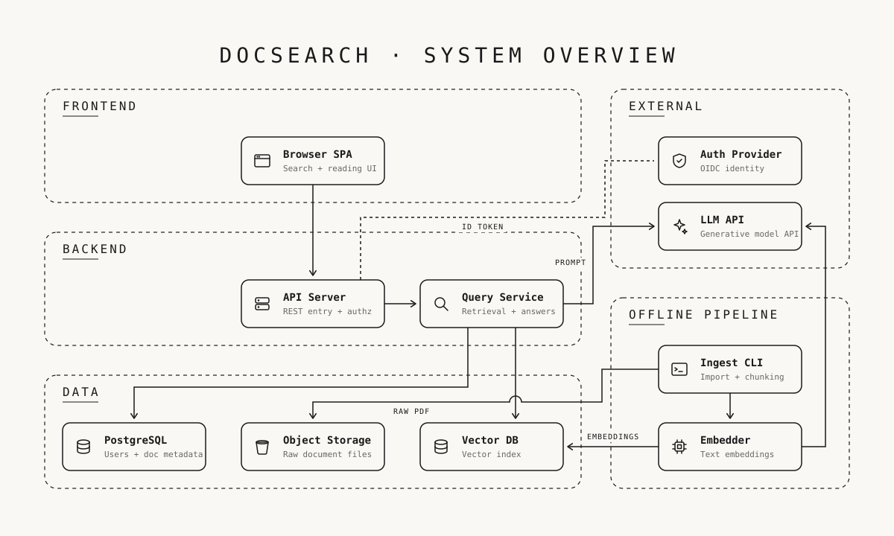

<div align="center">

# arch-blueprint

**An agent skill that turns any software repo into a one-page, black-and-white blueprint-style architecture diagram (SVG).**

把任何程式專案畫成一張「黑白線條藍圖風格」的系統架構總覽圖。



</div>

## What it does

Ask your agent in plain words — *"畫一張這個專案的架構圖"* or *"draw an architecture overview of this repo"* — and the skill will:

1. Read the project (README, entry points, folder layout, imports) and find the real module boundaries.
2. Propose the zones × nodes × data flows as text and **wait for your confirmation**.
3. Write a single self-contained `docs/architecture/overview.svg`.
4. Run `scripts/check.py` and fix every reported violation before handing it over.

**Style is deliberately fixed:** cream paper `#faf8f4`, ink `#1a1a1a`, nothing else. No gradients, no shadows, no color-coding. Dashed rounded containers for layers, 24 px line icons, open V-shaped arrowheads, JetBrains Mono. All text inside the diagram is English, whatever language you prompt in. Flow labels (`PROMPT`, `EMBEDDINGS`) go only on edges whose payload isn't obvious from the two node names — at most six per diagram.

**Scope is deliberately narrow:** one overview per project, ≤ 12 nodes, ≤ 12 edges. If it doesn't fit, the decomposition is too fine — not the font.

## Install

Any host that reads [Agent Skills](https://agentskills.io) (Claude Code, Codex, Cursor, Gemini CLI, …):

```bash
npx skills add cholateio/arch-blueprint
```

Claude Code plugin marketplace:

```text
/plugin marketplace add cholateio/arch-blueprint
/plugin install arch-blueprint@arch-blueprint
```

Manual: copy `skills/arch-blueprint/` into `~/.claude/skills/` (or your host's skills directory).

## Checking a diagram

The checker needs only the Python standard library:

```bash
python3 skills/arch-blueprint/scripts/check.py docs/architecture/overview.svg
```

It verifies what the style guide says in numbers: two colors only, English-only text, node/edge/label counts, 60 px margins, container padding, node spacing, 4 px grid, text overflow estimates, icons copied verbatim from the library, flow labels sitting beside their own edge and over nothing else, and the connector rules — orthogonal only, no transit through nodes or labels, arrowheads stopping 6 px short, fan-out attach points ≥ 12 px apart, no overlapping strokes, a hop at every unavoidable crossing. Exit code 1 on any error.

## Repository layout

```
skills/arch-blueprint/
├── SKILL.md                  # the skill: workflow, content rules, style spec, checklist
├── assets/icons.svg          # 13 line icons as <symbol>s — copy verbatim
├── assets/example-overview.svg
└── scripts/check.py          # stdlib-only verifier
tests/test_check.py           # python3 -m unittest discover -s tests
```

## 中文說明

- **用途**：只畫軟體專案的 overview 架構圖，不是通用繪圖工具。
- **流程**：分析專案 → 提案「分區 × 節點 × 資料流」並等你確認 → 產出 SVG → 跑 `check.py` 自檢。
- **風格固定**：米白底、墨黑線、分層虛線容器、線條 icon；不做換色、不做其他圖型。圖內文字一律英文。
- **提示**：第三方 skill 本質是一份純文字指令，安裝前請先讀過 `SKILL.md`；本專案的腳本不連網、不安裝任何套件。

## Credits

Structure and the idea of a script-verified taste gate were inspired by [cathrynlavery/diagram-design](https://github.com/cathrynlavery/diagram-design). The visual style here is its own and intentionally not skinnable.

## License

MIT
